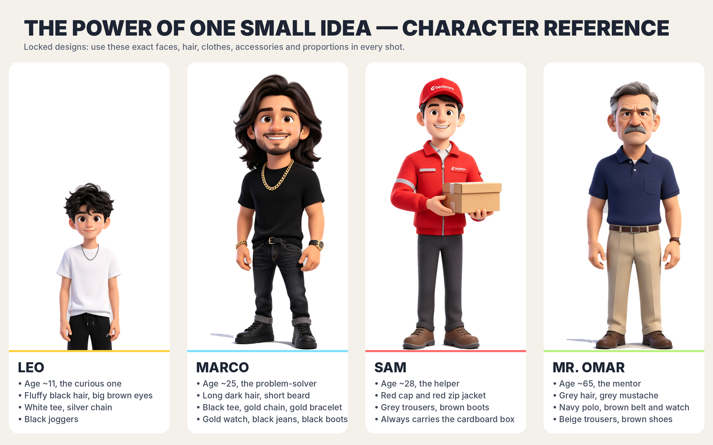

# The Power of One Small Idea

**Format:** YouTube Shorts / TikTok / Instagram Reels, vertical 9:16, 1080x1920, 30 fps, exactly 60.0 s
**Style:** Stylized 3D characters (the four uploaded references, cut out and locked) in an animated 2.5D garden set: parallax layers, a moving camera, weather and lighting changes, lip-synced mouths, and karaoke-style English captions
**Theme:** science + teamwork + saving water
**Final message:** "Think Smart. Save Water. Change the World."

## 1. Character reference (locked)



The originals are in `refs/` and the cut-outs used in every shot are in `assets/`. The renderer never redraws a character. It always uses these pixels, so faces, hair, clothes, accessories and proportions stay identical in every scene.

| Ref | Name | Role | Design notes (never change) |
|-----|------|------|-----------------------------|
| `refs/boy.jpg` | **LEO** (~11) | The curious one who notices the problem | Fluffy black hair, large brown eyes, white T-shirt, silver chain, black joggers |
| `refs/young_man.jpg` | **MARCO** (~25) | The problem-solver who finds and fixes the leak | Long dark hair, short beard, black tee, gold chain, gold bracelet, gold watch, black jeans, black boots |
| `refs/delivery.jpg` | **SAM** (~28) | The helper who brings reusable containers | Red cap, red zip jacket with reflective stripes, grey trousers, brown boots, cardboard box |
| `refs/elder.jpg` | **MR. OMAR** (~65) | The mentor who teaches the science | Grey hair, grey mustache, navy polo, brown belt and watch, beige trousers, brown shoes |

**Fixed set:** one neighborhood garden, used in every scene. It has a cream house with a red roof on the left, a raised garden bed with sunflowers in the middle, an old grey water pipe with a rusty joint on the right, a picket fence, and hills behind.

**Continuity:**
- The leak stays repaired once fixed. The puddle dries over the next 5 s.
- The two blue containers stay in place after Scene 4.
- The gutter and downspout stay up after they're built.
- Plant health goes 12% → 100% only after the rain.
- The grass gets greener in steps: dry, then after the rain, then at the bloom.

## 2. Storyboard

| # | Time | Camera and action | Dialogue | Sound |
|---|------|-------------------|----------|-------|
| 1 Hook | 0–10 s | Hot orange sky. A high wide shot of the wilted garden pushes in to Leo. Hook title: **"WHY IS THIS GARDEN DYING?"** The camera drifts right toward the pipe. | **LEO:** "Our garden is dying... but we water it every single day!" / "So where is all the water going?" | Cicadas, faint drips, uneasy Am–F–C–G pad |
| 2 The Leak | 10–20 s | Whip-flash cut to an extreme close-up of the dripping joint and puddle. Pull back as Marco walks in. Info card: **1 drip per second wastes over 11,000 liters a year.** | **MARCO:** "Wait... hear that dripping?" / "This old pipe is leaking! The water never reaches the plants." | Loud drips in the close-up, footsteps, card ding, plucked arpeggio |
| 3 The Mentor | 20–30 s | Mr. Omar walks in from the left. Push in as Marco repairs the joint with a wrench: sparkles, the drips stop, and the sprinkler finally waters the bed. Info card: **1 mm of rain on 1 m² = 1 liter of free water.** | **MR. OMAR:** "Fix the leak first. Then let the sky help you." / "One millimeter of rain on one square meter gives one liter of water." | Wrench clanks, success chime, bass enters |
| 4 The Delivery | 30–40 s | Continuous pan left to the house. Sam arrives, and two reusable containers fly out of his box. A wide shot shows the gutter and downspout building along the roof. | **SAM:** "Special delivery! Reusable containers!" **LEO:** "We can catch the rain from the roof!" **MARCO:** "Let's build it together!" | Pops, ratchet clicks, upbeat drums |
| 5 The Rain | 40–50 s | Lightning flash, then storm light. Rain runs along the gutter and down the spout into the containers, and the water level rises. Counter: **RAINWATER SAVED 0 → 400 L**. Pull back to the team in the rain. | **MR. OMAR:** "Science plus teamwork. That's how small ideas grow." **LEO:** "Look! The tanks are filling up!" | Thunder, rain, gutter trickle, half-time groove |
| 6 The Garden Lives | 50–60 s | Sunburst. A rainbow appears, the plants straighten, and the sunflowers and flowers bloom with sparkles. All four stand together. Title builds line by line: **Think Smart. / Save Water. / Change the World.** Fade out. | **LEO:** "One small idea... saved our whole garden!" **MR. OMAR:** "Think smart. Save water. Change the world." | Rising bells, birdsong, three title hits, final chord |

Educational facts used (rounded, widely published):
- A faucet dripping once per second wastes about 3,000 US gallons (≈11,000 L) a year. This is the US EPA WaterSense figure.
- 1 mm of rainfall on 1 m² is exactly 1 liter.

## 3. Voices

The render has no recorded dialogue yet, because this environment can't reach a text-to-speech service. Captions carry the lines, and the mouths animate from the line timing.

To add natural voices:
1. Record or generate the 13 lines in `timeline.json` (`L01`…`L13`). Each line has to fit inside its time slot.
2. Save them as `audio/lines/L01.mp3` … `audio/lines/L13.mp3`. `.wav` and `.m4a` also work.
3. Run `./render.sh`.

The script mixes the voices in, ducks the music under them, and drives the mouth shapes from each voice file's loudness, so the lip-sync follows the real speech.

Suggested casting (ElevenLabs or similar, English):
- **LEO:** young, bright, curious boy
- **MARCO:** warm, energetic young man
- **SAM:** cheerful, friendly courier
- **MR. OMAR:** calm, wise, slightly gravelly older man

## 4. Optional AI-video upgrade

To make full-motion clips with Kling / Seedance / Veo image-to-video, use `character_sheet.png` plus the matching `refs/*.jpg` as references for each scene. Start every prompt with this line:

> Premium stylized 3D animated film, Pixar-like, cinematic soft lighting, vertical 9:16. Keep the exact character designs from the reference images (faces, hair, clothes, accessories, proportions).

Then add the scene's row from the storyboard above.

## 5. Publishing

**Title:** One Small Idea Saved This Dying Garden 🌱💧 #shorts
**Description:**
A leaking pipe was killing their garden... until four neighbors used science and teamwork. 💡
💧 1 drip per second wastes over 11,000 liters a year
🌧️ 1 mm of rain on 1 m² = 1 liter of free water
Think Smart. Save Water. Change the World. 🌍
**Hashtags:** #shorts #savewater #science #teamwork #animation #education #rainwaterharvesting #kids
**Captions file:** `captions.en.srt` (upload it to YouTube as English subtitles)

## 6. Build

```
./render.sh        # -> output/final.mp4 (about 2-3 minutes)
node record.js --stills 5,15,45   # quick preview frames -> output/still_*.png
```

| File | Role |
|------|------|
| `timeline.json` | Single source of truth: scenes, character positions, dialogue timing, cards, story events |
| `scene.html` | Canvas renderer. The camera keyframes are `CAM`, and each element of the set is its own function |
| `record.js` | Steps the renderer frame by frame into video with Playwright and ffmpeg |
| `audio.py` | Synthesized score and sound effects, plus dialogue mixing, lip-sync envelopes and SRT export |
| `cutout.py` | Removes the studio background from the reference images |
| `refsheet.py` | Builds `character_sheet.png` |

Requirements: Python 3 with numpy and Pillow, Node with Playwright (Chromium), and ffmpeg.
